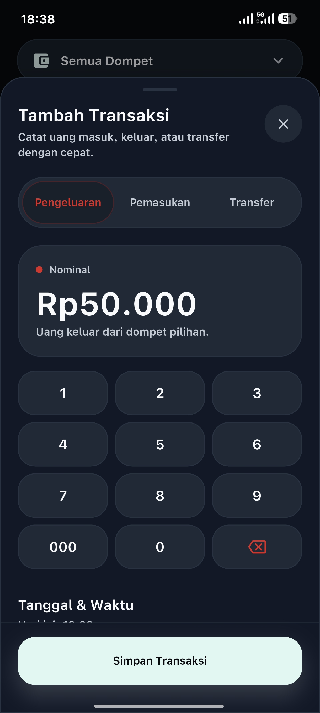
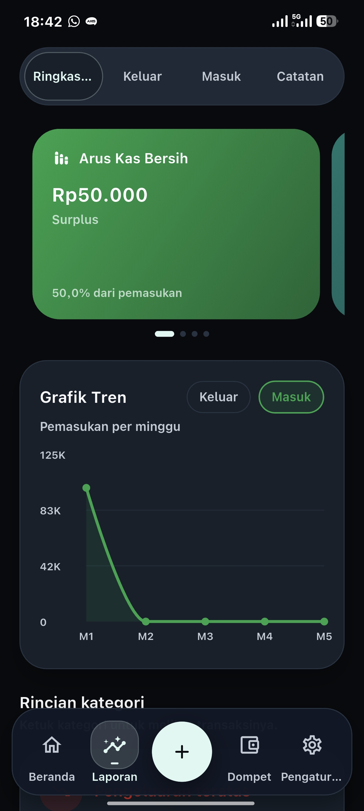

<p align="center">
  
</p>

<h1 align="center">MyWallet</h1>

<p align="center">
  Offline-first personal finance tracker for Android.
</p>

<p align="center">
  MyWallet helps users record income, expenses, wallets, budgets, data backups, and app updates locally on their devices.
</p>

<p align="center">
  <a href="https://github.com/fadd3079-prog/faddompet/actions/workflows/flutter-ci.yml"></a>
  
  
  <a href="LICENSE"></a>
  <a href="https://github.com/fadd3079-prog/faddompet/releases/latest"></a>
  
</p>

## Screenshots

<p align="center">
  
  
  
  
</p>

<p align="center">
  
  
  
</p>

## Features

- Income and expense tracking
- Wallet management
- Transfer between wallets
- Monthly budgets
- Analytics and summaries
- Local app lock with PIN and optional biometric unlock
- Backup and restore for moving data between phones
- CSV transaction export
- In-app update checker with direct APK download
- Offline-first local storage

## Privacy Model

- No account
- No cloud sync
- No ads
- No analytics or tracking
- Data stays on the device
- Backup files contain financial data and should be stored safely

MyWallet uses the internet only for user-triggered actions such as checking app updates, downloading an APK update, opening external links, or sharing exported files through Android.

Current release APK name:

```txt
FadDompet-v1.4.0-arm64.apk
